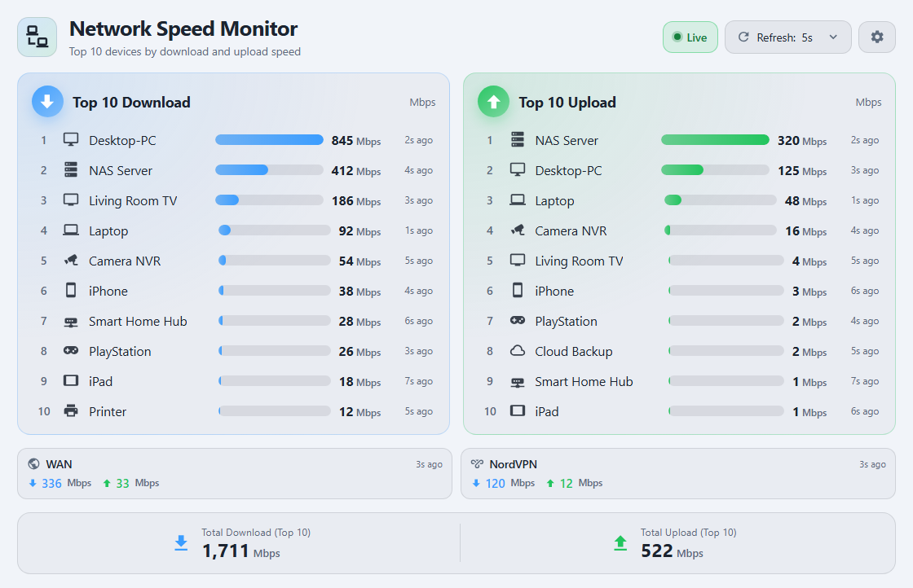
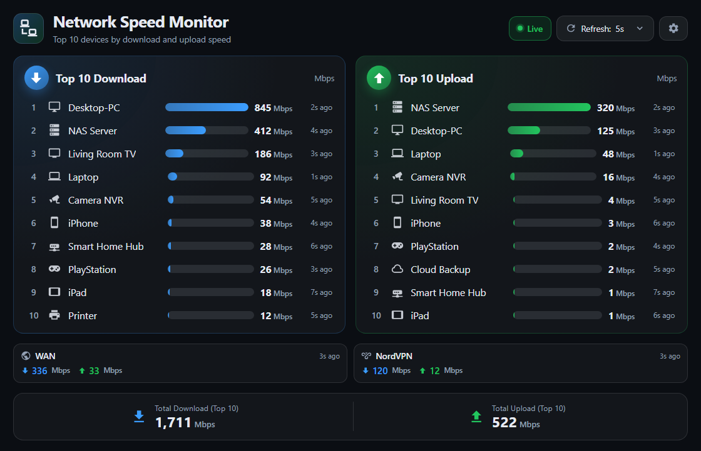

# Network Speed Monitor

A Home Assistant Lovelace card that ranks your network devices by **live download and upload
speed**. It reuses the bandwidth sensors you already have — UniFi, Fritz!Box, SNMP, OpenWrt, Glances,
template sensors, … — and renders two animated Top-N rankings plus Top-N totals.



<details>
<summary>Dark theme</summary>



</details>

## Features

- **Top 5 / 10 / 15 / 20 download and upload rankings**, side by side or stacked, with animated bars,
  device icons, ranking numbers and the age of each reading.
- **Automatic discovery** of sensors by unit, device class, entity name, device and integration.
  Manual pairing is available when discovery cannot match a device.
- **WAN, LAN and VPN interfaces** (OPNsense, pfSense, UniFi gateways, …) are recognised as
  interface-level sensors and shown in their own WAN / NordVPN strip, so they never pollute the
  per-device ranking.
- **Rate and counter support.** `bit/s`, `kbit/s`, `Mbit/s`, `Gbit/s`, `B/s`, `kB/s`, `MB/s`, `GB/s`,
  binary prefixes (`KiB/s`, `MiB/s`, …) and cumulative byte counters are all normalised to Mbps
  (optionally displayed as MB/s).
- **Display refresh control** (1 – 60 s) driven by Home Assistant state updates. The card never polls
  the source integration and shows how old each reading is, so a 1 s refresh never pretends to be a
  1 s measurement.
- **Light and dark themes.** The palette follows `--primary-text-color`, `--card-background-color`
  and `hass.themes.darkMode`, so it looks at home on a white dashboard as well as a dark one.
- **Visual editor** for every option, including integration/entity selection, manual pairs, name
  overrides and colors.
- **Built to scale:** 100+ sensors are fine — sorting happens on state updates, rendering is
  throttled to the refresh interval, timers and listeners are cleaned up on removal.
- Optional: search filter, pause, per-device aggregation (avoids counting an interface and a device
  sensor twice), utilisation thresholds, Top-N totals and 1 h sparklines from the recorder.

## Installation

### HACS (custom repository)

1. HACS → **Frontend** → ⋮ → **Custom repositories**.
2. Add `https://github.com/nikeng-forenade/ha-network-speed-monitor` with category **Lovelace**.
3. Install **Network Speed Monitor** and reload the browser (hard refresh).
4. Add the card: **Edit dashboard → Add card → Network Speed Monitor**.

### Manual

1. Download `network-speed-monitor.js` from the latest release.
2. Copy it to `/config/www/network-speed-monitor.js`.
3. Add the resource (Settings → Dashboards → ⋮ → Resources):

   ```yaml
   url: /local/network-speed-monitor.js
   type: module
   ```

4. Add the card and reload.

## Quick start

```yaml
type: custom:network-speed-monitor
title: Network Speed Monitor
subtitle: Top 10 devices by download and upload speed
```

Sensors are discovered automatically. If the card shows “No compatible bandwidth sensors found”,
open the card editor and select the sensors (or their integration) manually.

## How discovery works

For every entity the card checks, in this order:

1. Entity is not disabled/hidden and is not excluded by `exclude_entities`/`exclude_integrations`.
2. `unit_of_measurement` parses as a bit/byte rate (`…/s`) or a cumulative bit/byte counter.
3. The sensor looks like network traffic: `device_class: data_rate` / `data_size`, an interface name
   (`WAN`, `LAN`, `VPN`, `NordVPN`, `WireGuard`, `tun0`, `wg0`, `opt1`, …), or a name containing
   `speed`, `rate`, `bandwidth`, `throughput`, `traffic`, `download`, `upload`.
4. The direction is derived from the entity id, friendly name and translation key
   (`download|down|rx|in|receive|inbound` vs `upload|up|tx|out|sent|outbound`).
5. Disk, memory and CPU throughput (`MB/s` on a disk sensor, for example) is excluded.

Ambiguous sensors are skipped instead of guessed. Use `pairs` for those.

### WAN, LAN and VPN interfaces

Routers and firewalls expose traffic for whole interfaces, not for a single device. OPNsense, for
example, reports `WAN in`, `WAN out`, `NordVPN in`, `NordVPN out` as `kB/s` sensors.

These sensors are detected as **interface-level** and rendered in a separate strip below the two
rankings (`WAN ↓ 336 Mbps ↑ 33 Mbps`, `NordVPN ↓ 120 Mbps ↑ 12 Mbps`). Their traffic is the sum of
many devices, so they are kept out of the Top 10 by default. Change that with `aggregates`:

```yaml
aggregates: separate   # own strip (default)
# aggregates: inline   # rank WAN/VPN together with the devices
# aggregates: off      # ignore interface sensors completely
```

Interface names are recognised automatically (`wan`, `wan6`, `lan`, `wlan`, `guest`, `vpn`,
`nordvpn`, `wireguard`, `openvpn`, `ipsec`, `tun*`, `wg*`, `pppoe`, `opt1`…) and used as the strip
label. Override the label or icon with a `pairs` entry.

### Per-device usage through the VPN

The interface sensors only tell you the tunnel total. To see **which device** uses NordVPN, with real
per-device rates in this card, feed per-host data from ntopng into MQTT:

1. OPNsense: enable **os-ntopng** (or NetFlow via `os-softflowd`) and monitor the VPN interface.
2. Run [`docs/examples/netflow_to_mqtt.py`](docs/examples/netflow_to_mqtt.py) with
   `--ifid <VPN interface id>`.
3. The script publishes `sensor.netflow_<device>_download` / `_upload` with `device_class: data_rate`
   and `unit_of_measurement: Mbit/s`, so this card discovers them automatically.

```yaml
type: custom:network-speed-monitor
title: NordVPN clients
include_integrations:
  - mqtt
aggregates: off
```

Full walkthrough, including how to find the interface id and how to avoid double counting:
[docs/netflow-per-device-vpn.md](docs/netflow-per-device-vpn.md).

Prefer no extra process? A `rest` sensor pair per device inside Home Assistant is enough, because the
card converts cumulative byte counters to Mbps itself — see
[`docs/examples/netflow-ha-package.yaml`](docs/examples/netflow-ha-package.yaml).

### Cumulative counters

Cumulative counters (`B`, `kB`, `MiB`, …) are converted using the timestamps of the actual samples:

```
Mbps = (delta_bytes * 8) / (elapsed_seconds * 1_000_000)
```

Counter resets (device reboot, integration restart) are detected and treated as traffic since the
reset. A gap longer than `stale_after` drops the baseline, and implausible deltas (> 1 Tbps) are
ignored. The first reading of a counter is always shown as “waiting for the first reading”.

## Options

| Option | Type | Default | Description |
| --- | --- | --- | --- |
| `title` | string | `Network Speed Monitor` | Card title. |
| `subtitle` | string | `Top {n} devices by download/upload speed` | Card subtitle (adapted to `show`). |
| `show` | `both` \| `download` \| `upload` | `both` | Which rankings to render. |
| `layout` | `auto` \| `columns` \| `stacked` | `auto` | `auto`/`columns` are side by side on desktop and stack on mobile; `stacked` always stacks. |
| `ranking_size` | `5` \| `10` \| `15` \| `20` | `10` | Rows per ranking. |
| `refresh_interval` | `1`\|`2`\|`5`\|`10`\|`15`\|`30`\|`60` | `5` | Display refresh in seconds. |
| `unit` | `Mbps` \| `MBps` | `Mbps` | Display unit. |
| `decimals` | number | `0` | Decimals for values below 100. |
| `sort_direction` | `desc` \| `asc` | `desc` | Highest or lowest first. |
| `scope` | `entity` \| `device` | `entity` | `device` merges sensors of one device per direction (highest wins) to avoid double counting interface + device sensors. |
| `aggregates` | `separate` \| `inline` \| `off` | `separate` | How interface-level sensors (WAN, LAN, VPN tunnels) are shown. |
| `max_speed` | number | – | Mbps used as 100 % for bar scaling; omit to scale bars relative to the fastest device. |
| `warn_threshold` | number (%) | `75` | Bar turns orange at this share of `max_speed`. |
| `critical_threshold` | number (%) | `90` | Bar turns red at this share of `max_speed`. |
| `stale_after` | number (s) | `300` | Readings older than this are dimmed. |
| `hold_seconds` | number (s) | `60` | Keep the last value (dimmed) when a sensor turns `unavailable`, so rows do not vanish and the ranking does not jump. `0` removes them immediately. |
| `show_bars` | boolean | `true` | Show speed bars. |
| `show_rank` | boolean | `true` | Show ranking numbers. |
| `show_timestamps` | boolean | `true` | Show the age of each reading. |
| `show_icons` | boolean | `true` | Show device icons. |
| `show_totals` | boolean | `true` | Show Top-N totals. |
| `show_search` | boolean | `false` | Show a device filter. |
| `show_status` | boolean | `true` | Dot for stale/unknown readings. |
| `show_sparkline` | boolean | `false` | 1 h history line instead of the bar (requires recorder). |
| `compact` | boolean | `false` | Compact spacing. |
| `download_color` | hex | `#1a73e8` | Download accent (light theme; the dark theme keeps the same hue). |
| `upload_color` | hex | `#16a34a` | Upload accent. |
| `include_integrations` | string[] | – | Only use sensors from these integrations. |
| `exclude_integrations` | string[] | – | Ignore these integrations. |
| `include_entities` | string[] | – | Allow-list of sensors (disables automatic discovery). |
| `exclude_entities` | string[] | – | Sensors to ignore. |
| `pairs` | list | – | Manual pairing, see below. |
| `name_overrides` | map | – | `entity_id: Display name`. |

### Manual pairing

```yaml
type: custom:network-speed-monitor
pairs:
  - name: NAS Server
    download: sensor.nas_wan_down
    upload: sensor.nas_wan_up
    icon: mdi:server
```

A pair forces the direction (no name guessing) and lets you set the displayed name and icon.

## Examples

- [Basic card](examples/basic.yaml)
- [OPNsense with WAN and NordVPN interfaces](examples/opnsense.yaml)
- [Per-device speeds over NordVPN](examples/netflow-vpn.yaml)
- [Manual pairs and name overrides](examples/manual-pairs.yaml)
- [Separate download and upload cards](examples/separate-cards.yaml)
- [Compact card with thresholds](examples/compact.yaml)

## Development

```bash
npm install
npm test            # vitest unit tests
npm run check       # tsc --noEmit
npm run build       # dist/network-speed-monitor.js
npm run watch       # rebuild on change
```

Open `preview/preview.html` in a browser after building to see the card with sample data (no Home
Assistant required). Append `?dark=1` for the dark palette. `preview/editor-preview.html` renders the
visual editor against stub `ha-form`/`ha-selector` elements. The preview images under `docs/` are
generated with that harness.

## Releasing

1. Bump `version` in `package.json`.
2. `npm run build`, commit, `git tag v1.x.y`, `git push --tags`.
3. The release workflow builds the bundle and attaches `network-speed-monitor.js`, which is what HACS
   downloads.

## Troubleshooting

**Nothing is discovered.** The sensors probably use an unrecognised unit or name. Open the card
editor → *Only use these sensors* and pick them manually, or add a `pairs` entry.

**Values look 8× too small/large.** The integration reports bytes but names the unit `Mb/s` (or the
other way around). Fix the unit in the source sensor, or use a template sensor with the correct unit.

**Download values stay at “waiting for the first reading”.** The sensor is a cumulative counter; the
card needs two samples. This is expected for the first update interval after a page load.

**A device disappeared from the list.** A sensor that turns `unavailable` (laptop asleep, Wi-Fi drop,
integration reload) is normally removed from the ranking. `hold_seconds` (default `60`) keeps the last
speed, dimmed, for that long so the list does not jump. Set it to `0` to remove rows immediately.

**Everything is 0.** Many routers report 0 when idle. Check the sensor in Developer Tools → States.

**Sparklines are missing.** They require the recorder and at least two history points in the last
hour; the option is off by default.

**The card is huge.** Set `ranking_size: 5`, `compact: true` and/or `show_timestamps: false`.

**The gear → “Edit card…” does nothing.** That shortcut needs Home Assistant's card dialogs; use
dashboard edit mode (⋮ → Edit dashboard → pencil on the card) instead — the same visual editor opens.

## License

MIT
